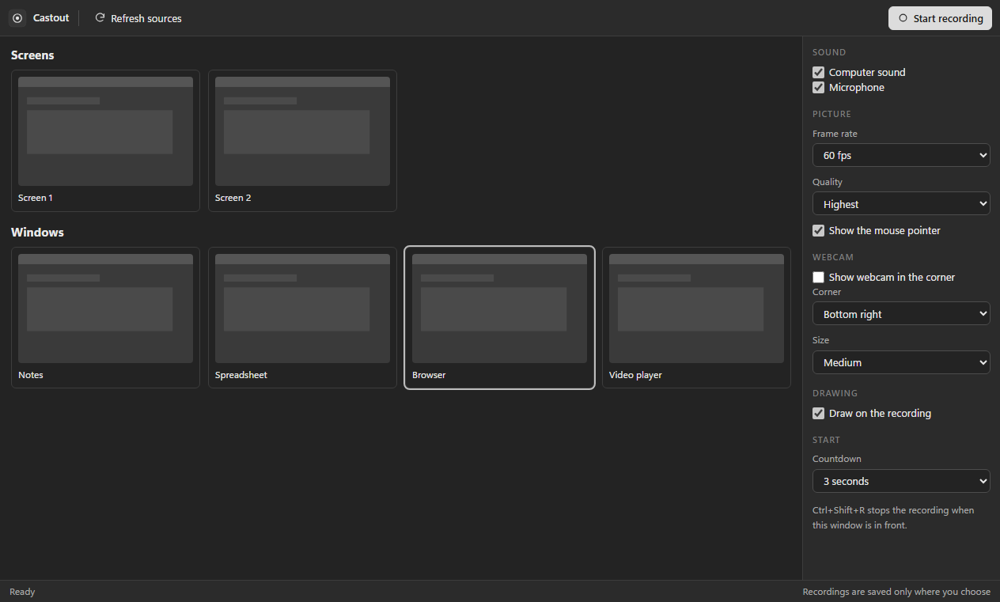
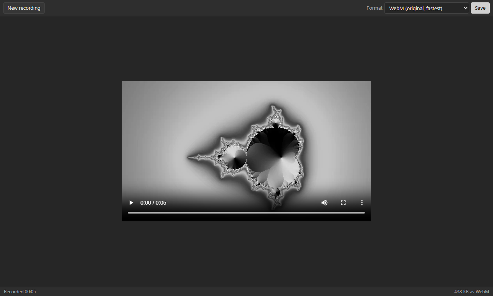
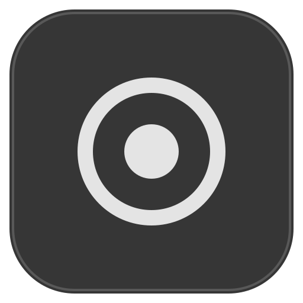

<h1 align="center">Castout</h1>

<b>Record your screen</b> Version 1.0.15 for Windows · Free · Offline · No account

<a href="https://github.com/plawanpawin-byte/castout/releases/latest"><b>Download Castout</b></a> · <a href="https://github.com/plawanpawin-byte/lookout-launcher">Lookout launcher</a> · <a href="https://github.com/plawanpawin-byte/Lookout">All Lookout apps</a>

---

Castout records your screen or a single window, with computer sound and an optional microphone. Choose what to capture, press start after a short countdown, then review the clip and save it as WebM, MP4, GIF or MP3.

**Made for:** Tutorials, bug reports, demos, game clips and meetings you need to keep.

**On this page:** [In plain words](#in-plain-words) · [Who it is for](#who-it-is-for) · [Try it in 3 steps](#try-it-in-3-steps) · [Screenshots](#see-it-in-action) · [Features](#everything-it-can-do) · [How to use it](#how-to-use-it) · [Privacy](#private-by-design) · [Install](#install) · [Questions](#questions)

## In plain words

Castout **records what is on your screen** as a video. Use it for a tutorial ("here is how to do this"), to show a bug to a colleague, to save a video call you are allowed to record, or to capture a game moment. You choose the whole screen or one window, decide whether to record computer sound and your **microphone**, and press start. A short countdown gives you time to get ready.

When you stop, you see the clip, can play it, and save it as **MP4, WebM, GIF or MP3** (audio only).

**Not for:** Castout records and saves. To edit the recording, open it in Cutout.

## Who it is for

- **Teachers and trainers** creating how-to videos.
- **Support teams** showing a problem to a developer.
- **Gamers and creators** capturing clips.

## Try it in 3 steps

1. Click the screen or window you want to record.
2. Turn the microphone on or off in the options, then click **Start recording**.
3. Click **Stop and review**, watch the clip, then **Save** it as MP4.

## What is new in 1.0.15

A new look inspired by Google's own tools (AI Studio, Colab, Gemini): a calm dark charcoal theme, rounded pill buttons, a soft blue accent and roomier spacing. The app icon is now a colour logo so you can find Castout at a glance in the Start menu and in the Lookout launcher. All screenshots below were taken again with the new look. The program now shows under its own name (not Electron) in Task Manager and the taskbar.

## In plain words

Castout **records what is on your screen** as a video. Use it for a tutorial ("here is how to do this"), to show a bug to a colleague, to save a video call you are allowed to record, or to capture a game moment. You choose the whole screen or one window, decide whether to record computer sound and your **microphone**, and press start. A short countdown gives you time to get ready.

When you stop, you see the clip, can play it, and save it as **MP4, WebM, GIF or MP3** (audio only).

**Not for:** Castout records and saves. To edit the recording, open it in Cutout.

## Who it is for

- **Teachers and trainers** creating how-to videos.
- **Support teams** showing a problem to a developer.
- **Gamers and creators** capturing clips.

## Try it in 3 steps

1. Click the screen or window you want to record.
2. Turn the microphone on or off in the options, then click **Start recording**.
3. Click **Stop and review**, watch the clip, then **Save** it as MP4.

## See it in action

### Choose what to record

Pick a whole screen or a single window. The thumbnails on this page are placeholders made for the picture; in the app you see live previews.

### Options

Computer sound, microphone, frame rate, quality, mouse pointer and a start countdown.

### Recording

A running timer with Pause and Stop. Press Ctrl + Shift + R to stop while Castout is in front.

### Review and save

Play the take back and choose a format.

### Saved

The file is written only where you choose.

### Output

A frame from the saved MP4.

## The interface

- **Top bar:** refresh the list of screens and windows, and start recording.
- **Centre:** large previews of each screen and window; click one to choose it.
- **Right panel:** sound, picture and countdown options. After recording, the centre shows the take with a format picker and a Save button.

## Everything it can do

### Capture

- Any screen or any window
- Computer sound and microphone, mixed together
- Frame rates from 15 up to 60
- Show or hide the mouse pointer

### Control

- Countdown before recording starts
- Pause and resume
- Stop and review

### Save

- WebM (fastest, no conversion)
- MP4 for playing anywhere
- GIF (first 30 seconds)
- MP3 for sound only

## How to use it

1. Open Castout and click the screen or window you want.
2. Choose sound, frame rate and quality in the right panel.
3. Click **Start recording**. After the countdown, carry on as normal.
4. Click **Stop and review**, watch the clip and pick a format.
5. Click **Save** and choose a location.

## Keyboard shortcuts

| Keys | What it does |
| --- | --- |
| Ctrl + Shift + R | Stop recording (when Castout is in front) |

## Files and formats

Saves WebM, MP4, GIF and MP3.

## Private by design

- No account, no sign-in, no subscription, no ads.
- Castout works offline. It never uses the network.
- Files are opened and saved only through the Windows file dialogs you use. Castout cannot browse your disk on its own.
- The app window runs in a locked-down sandbox with a strict content policy.

## Install

1. Open the [latest release](https://github.com/plawanpawin-byte/castout/releases/latest) and download the file named **Castout-Setup-** followed by the version number and **.exe**. You can also install it from the [Lookout launcher](https://github.com/plawanpawin-byte/lookout-launcher), which keeps it up to date.
2. Run the installer. It installs just for you, so it does not ask for administrator rights.
3. Windows may show a blue **Windows protected your PC** screen because these installers are not signed with a paid certificate. Click **More info**, then **Run anyway**.
4. Open Castout from the Start menu.

**Requirements:** Windows 10 or 11, 64-bit. About 500 MB of free disk space. No internet connection is needed to use the app.

## Questions

**Where do recordings go?**  
Nowhere until you press Save and choose a place.

**Does it upload anything?**  
No. Castout does not use the network.

**Windows asks about screen capture. Why?**  
Capturing the screen needs your permission; Castout only captures what you pick.

**Does it record sound?**  
Yes: computer sound, your microphone, or both, as you choose.

**Why is my GIF big?**  
GIFs are large by nature. Keep clips short, or save as MP4.

**Can I record a single window?**  
Yes. Click the window instead of the whole screen.

**Does it record sound?**  
Yes: computer sound, your microphone, or both, as you choose.

**Why is my GIF big?**  
GIFs are large by nature. Keep clips short, or save as MP4.

**Can I record a single window?**  
Yes. Click the window instead of the whole screen.

## About Lookout

Castout is part of **[Lookout](https://github.com/plawanpawin-byte/Lookout)**: ten small, private Windows apps for documents and media that share one look and one promise, that your files stay on your computer. Install and update them together with the [Lookout launcher](https://github.com/plawanpawin-byte/lookout-launcher).

| | App | What it is for | Code |
| --- | --- | --- | --- |
|  | **Lookout** | Install, open and update all the apps below | [GitHub](https://github.com/plawanpawin-byte/lookout-launcher) |
|  | **PDFout** | Read, annotate and sign PDFs | [GitHub](https://github.com/plawanpawin-byte/pdfout) |
|  | **Chartout** | Flowcharts, org charts and diagrams | [GitHub](https://github.com/plawanpawin-byte/chartout) |
|  | **Branchout** | Mind maps and outlines | [GitHub](https://github.com/plawanpawin-byte/branchout) |
|  | **Planout** | Project plans and Gantt timelines | [GitHub](https://github.com/plawanpawin-byte/planout) |
|  | **Frameout** | App and web screen design with click-through prototypes | [GitHub](https://github.com/plawanpawin-byte/frameout) |
|  | **Cutout** | Video editing on a timeline | [GitHub](https://github.com/plawanpawin-byte/cutout) |
|  | **Shiftout** | Convert and compress video and audio, make GIFs | [GitHub](https://github.com/plawanpawin-byte/shiftout) |
|  | **Castout** | Record your screen | [GitHub](https://github.com/plawanpawin-byte/castout) |
|  | **Mendout** | Check and repair damaged video, audio, pictures and PDFs | [GitHub](https://github.com/plawanpawin-byte/mendout) |
|  | **Tuneout** | Record and edit audio | [GitHub](https://github.com/plawanpawin-byte/tuneout) |

Released under the MIT License.
