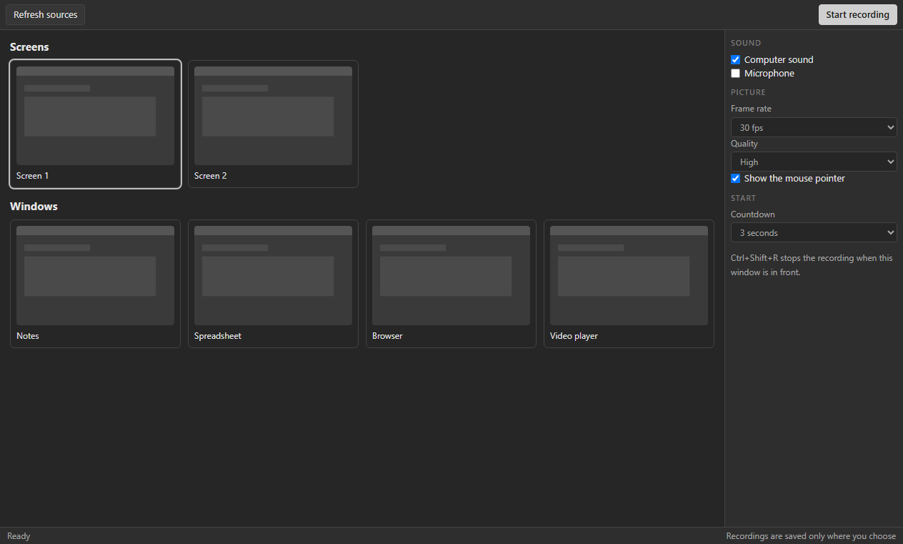

# Castout

A private screen recorder for Windows. Pick a screen or a single window, press record and save the result as a video, a GIF or just the sound. No account, no subscription, no watermark and no internet connection needed.

## What you can do

- **Record a whole screen or a single window**
- **Add computer sound and your microphone** to the same recording
- **Choose 15, 30 or 60 frames per second** and the quality that suits your file size
- **Countdown before you start**, pause and resume while recording
- **Review the take** before saving anything
- **Save as** WebM, MP4, an animated GIF or MP3 sound only

## Your files stay on your computer

Castout works entirely offline. There is no account, no upload and no tracking. Nothing is saved until you choose a place for it.

## Download

Get **Castout-Setup-1.0.0.exe** from the [Releases](../../releases/latest) page and run it.

Part of the [Lookout](https://github.com/plawanpawin-byte/Lookout) family of apps.

Released under the MIT License. Media processing uses FFmpeg, which is licensed under the GNU GPL.
