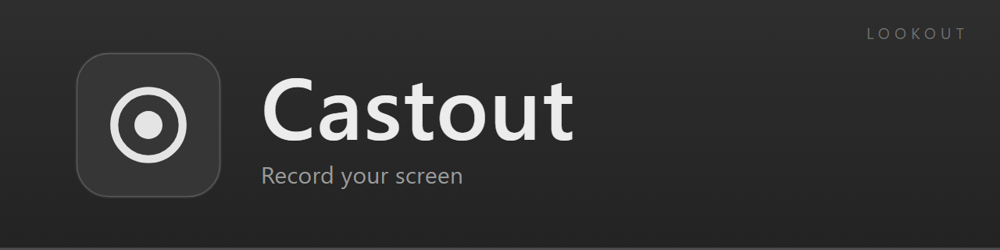
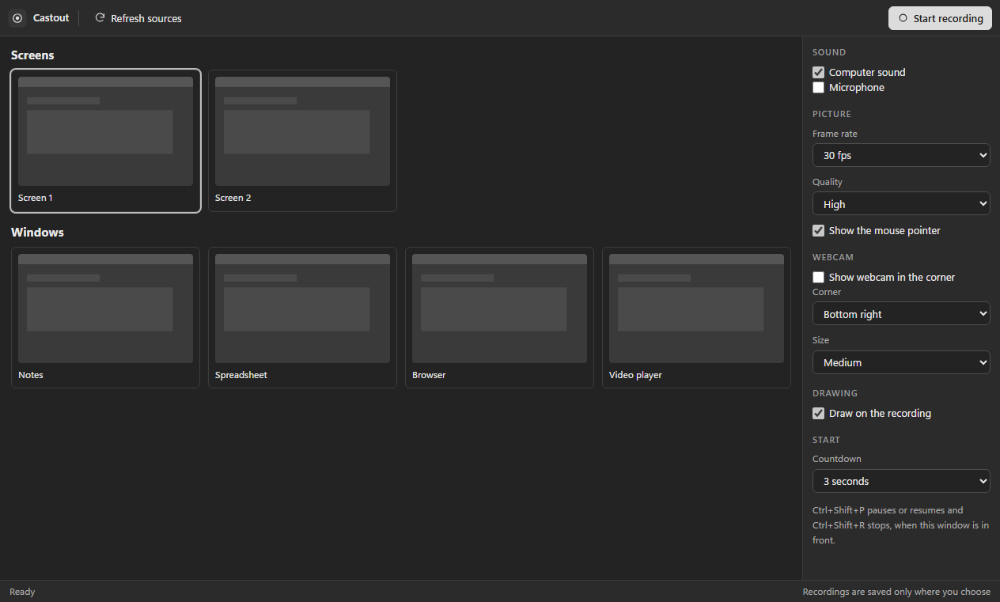
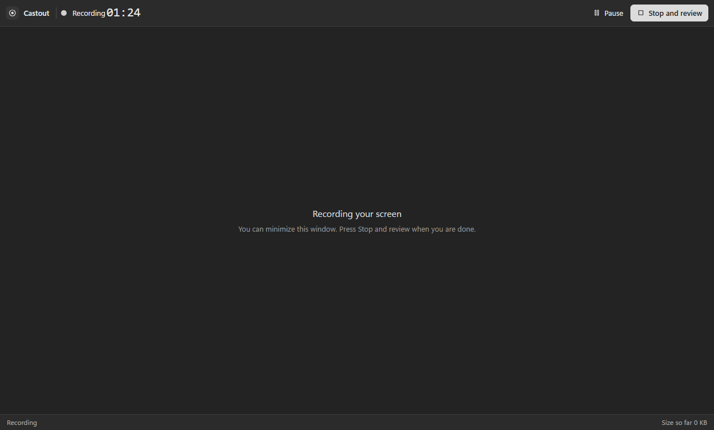
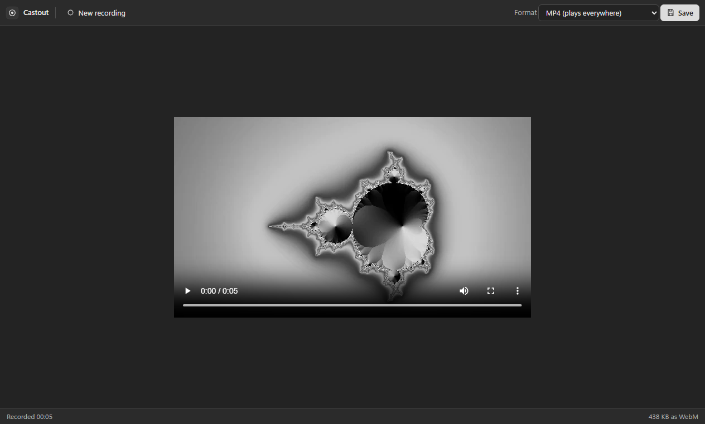

<b>Record your screen</b> Version 1.0.3 for Windows · Free · Offline · No account

<a href="https://github.com/plawanpawin-byte/castout/releases/latest"><b>Download Castout</b></a> · <a href="https://github.com/plawanpawin-byte/Lookout">All Lookout apps</a>

---

Castout records your screen or a single window, with computer sound and an optional microphone. Choose what to capture, press start after a short countdown, then review the clip and save it as WebM, MP4, GIF or MP3.

**Made for:** Tutorials, bug reports, demos, game clips and meetings you need to keep.

**On this page:** [Screenshots](#see-it-in-action) · [Interface](#the-interface) · [Features](#everything-it-can-do) · [How to use it](#how-to-use-it) · [Shortcuts](#keyboard-shortcuts) · [Formats](#files-and-formats) · [Privacy](#private-by-design) · [Install](#install) · [Questions](#questions)

## What is new in 1.0.3

A refreshed interface: every toolbar button now has a clear line icon, the app's mark sits at the top left, controls share one height and spacing, panels line up in tidy grids, and the toolbar keeps every button reachable on smaller windows by switching less important buttons to icons.

## See it in action

### Choose what to record

Pick a whole screen or a single window. The thumbnails on this page are placeholders made for the picture; in the app you see live previews.

### Options

Computer sound, microphone, frame rate, quality, mouse pointer and a start countdown.

### Recording

A running timer with Pause and Stop. Press Ctrl + Shift + R to stop while Castout is in front.

### Review and save

Play the take back and choose a format.

### Saved

The file is written only where you choose.

### Output

A frame from the saved MP4.

## The interface

- **Top bar:** refresh the list of screens and windows, and start recording.
- **Centre:** large previews of each screen and window; click one to choose it.
- **Right panel:** sound, picture and countdown options. After recording, the centre shows the take with a format picker and a Save button.

## Everything it can do

### Capture

- Any screen or any window
- Computer sound and microphone, mixed together
- Frame rates from 15 up to 60
- Show or hide the mouse pointer

### Control

- Countdown before recording starts
- Pause and resume
- Stop and review

### Save

- WebM (fastest, no conversion)
- MP4 for playing anywhere
- GIF (first 30 seconds)
- MP3 for sound only

## How to use it

1. Open Castout and click the screen or window you want.
2. Choose sound, frame rate and quality in the right panel.
3. Click **Start recording**. After the countdown, carry on as normal.
4. Click **Stop and review**, watch the clip and pick a format.
5. Click **Save** and choose a location.

## Keyboard shortcuts

| Keys | What it does |
| --- | --- |
| Ctrl + Shift + R | Stop recording (when Castout is in front) |

## Files and formats

Saves WebM, MP4, GIF and MP3.

## Private by design

- No account, no sign-in, no subscription, no ads.
- Castout works offline. It never uses the network.
- Files are opened and saved only through the Windows file dialogs you use. Castout cannot browse your disk on its own.
- The app window runs in a locked-down sandbox with a strict content policy.

## Install

1. Open the [latest release](https://github.com/plawanpawin-byte/castout/releases/latest) and download the file named **Castout-Setup-** followed by the version number and **.exe**. You can also install it from the [Lookout launcher](https://github.com/${OWNER}/lookout-launcher), which keeps it up to date.
2. Run the installer. It installs just for you, so it does not ask for administrator rights.
3. Windows may show a blue **Windows protected your PC** screen because these installers are not signed with a paid certificate. Click **More info**, then **Run anyway**.
4. Open Castout from the Start menu.

**Requirements:** Windows 10 or 11, 64-bit. About 500 MB of free disk space. No internet connection is needed to use the app.

## Questions

**Where do recordings go?**  
Nowhere until you press Save and choose a place.

**Does it upload anything?**  
No. Castout does not use the network.

**Windows asks about screen capture. Why?**  
Capturing the screen needs your permission; Castout only captures what you pick.

## About Lookout

Castout belongs to the **[Lookout](https://github.com/plawanpawin-byte/Lookout)** family: ten small, private Windows apps for documents and media, all with the same calm grey look and the same promise that your files stay yours. Install and update them together with the [Lookout launcher](https://github.com/plawanpawin-byte/lookout-launcher).

- **[Pageout](https://github.com/plawanpawin-byte/pageout)**: read, annotate and sign pdfs
- **[Chartout](https://github.com/plawanpawin-byte/chartout)**: flowcharts and diagrams
- **[Branchout](https://github.com/plawanpawin-byte/branchout)**: mind maps and outlines
- **[Planout](https://github.com/plawanpawin-byte/planout)**: plans and gantt timelines
- **[Frameout](https://github.com/plawanpawin-byte/frameout)**: screen design and prototypes
- **[Cutout](https://github.com/plawanpawin-byte/cutout)**: video editing on a timeline
- **[Shiftout](https://github.com/plawanpawin-byte/shiftout)**: convert and compress media
- **[Mendout](https://github.com/plawanpawin-byte/mendout)**: repair damaged media
- **[Tuneout](https://github.com/plawanpawin-byte/tuneout)**: record and edit audio

Released under the MIT License.
